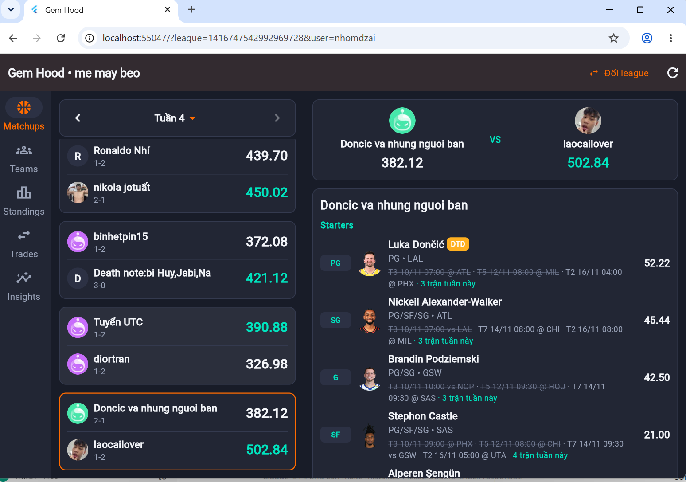
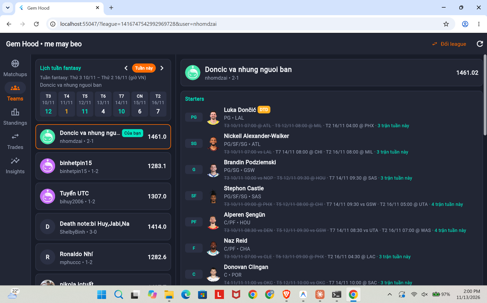
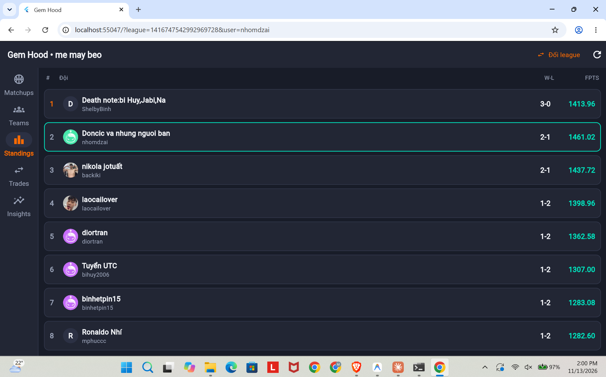
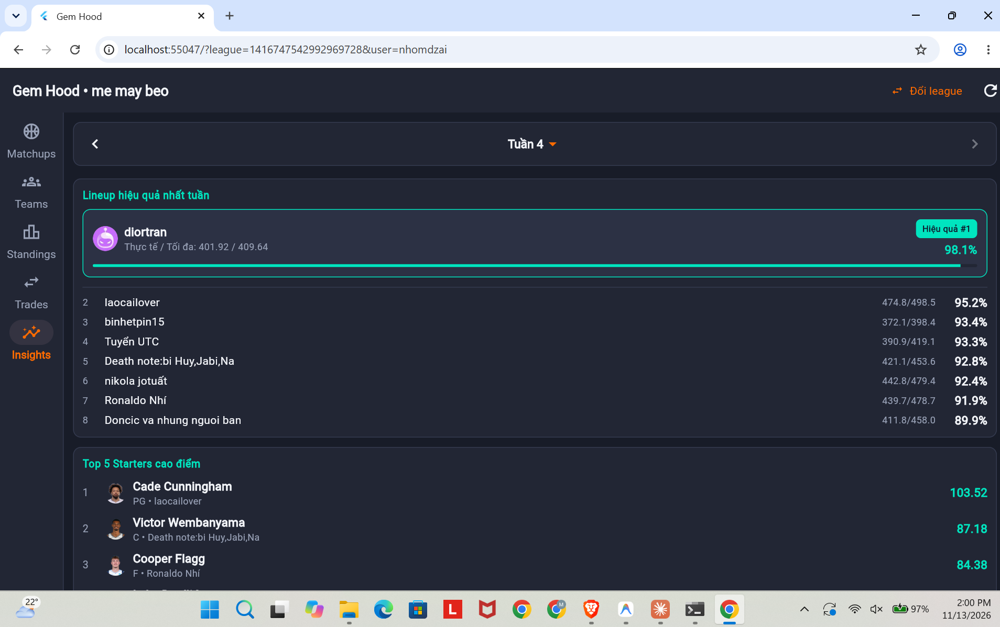
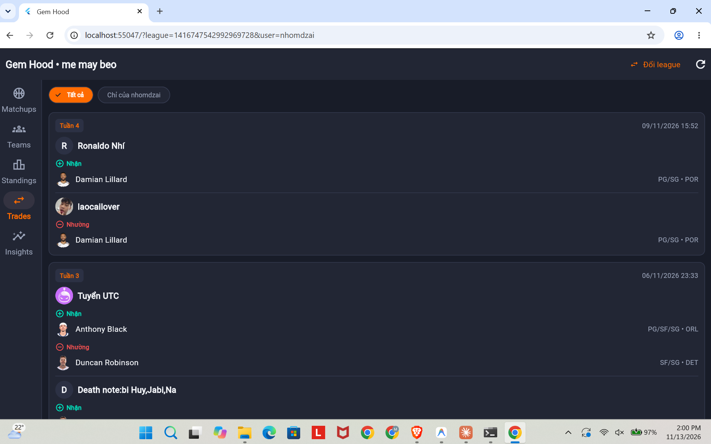
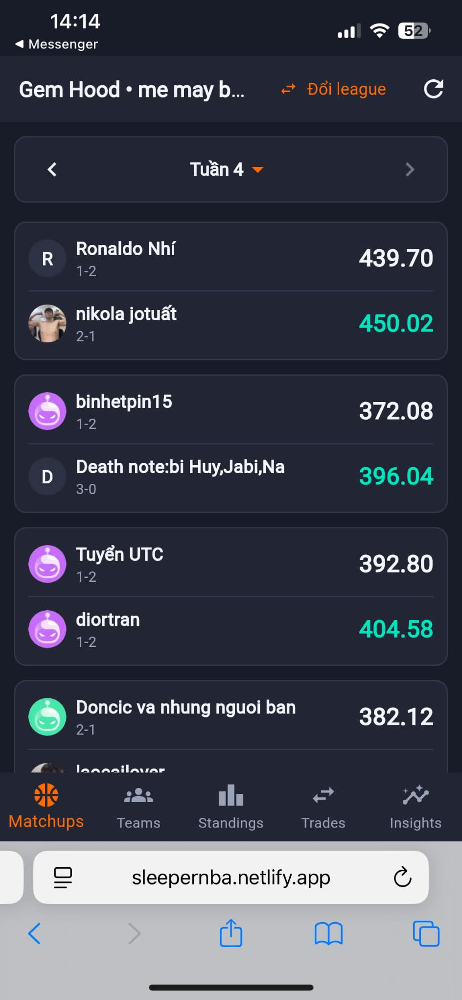
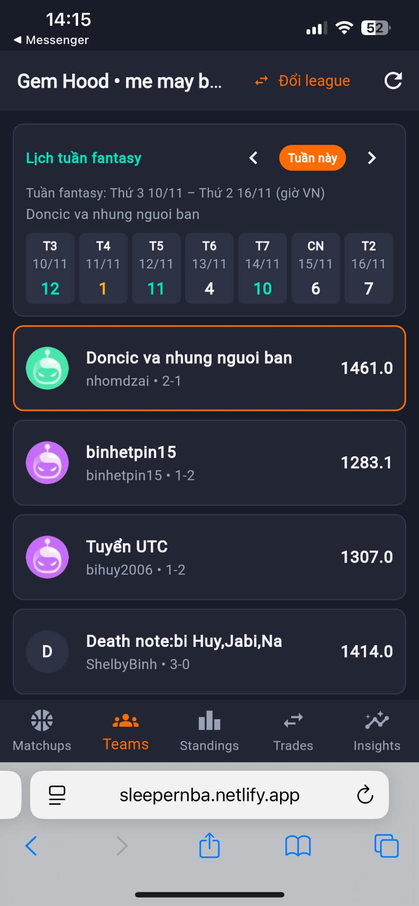
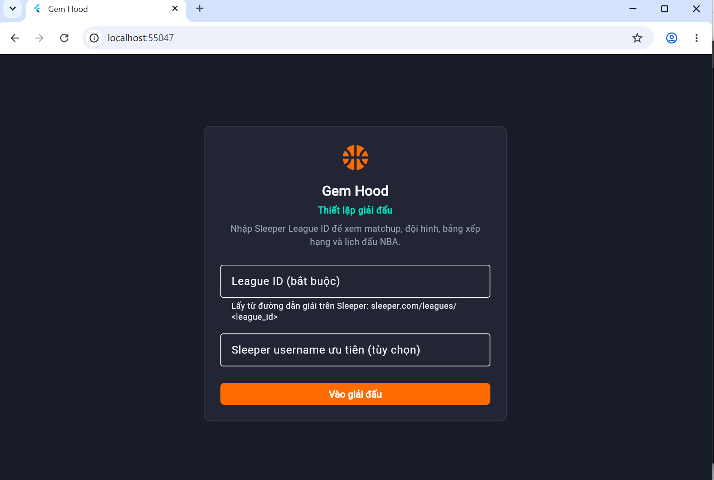
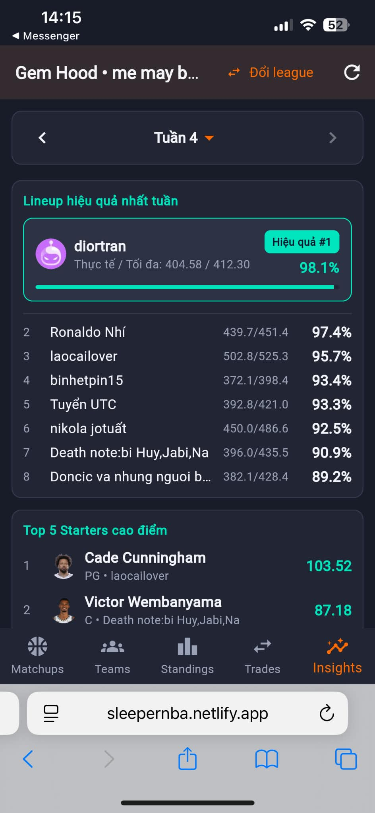

# Gem Hood

A responsive Flutter companion hub for Sleeper NBA Fantasy leagues—bringing full matchup, roster, standings, trade history, weekly insights, and fantasy-week NBA schedule views to web and mobile.

[](https://flutter.dev)
[](https://dart.dev)
[](LICENSE)

**Live Demo:** https://sleepernba.netlify.app

---

## Problem Statement

Sleeper's web interface currently blocks or restricts the **Team** and **Matchup** views for NBA fantasy leagues, forcing managers on desktop or mobile browsers to switch back to the native mobile app just to check daily lineups, scores, or opponent rosters. **Gem Hood** solves this by consuming Sleeper's public read-only API directly in a fast, responsive Flutter Web (PWA) and mobile client.

## Features

- **Matchups**: Weekly head-to-head matchups with week selector, Starters vs. Bench breakdown, live auto-refresh (60s), and per-player fantasy-week NBA game tags.
- **Teams**: Full league roster browser with Starters / Bench / IR sections, optional priority-manager pinning, and an interactive 7-day fantasy-week NBA schedule header.
- **Standings**: League table sorted by wins and total fantasy points (`FPTS` / `fpts_decimal`).
- **Trades**: Complete season trade log with week-level caching in `SharedPreferences`, draft pick tracking, and optional filtering for the configured manager.
- **Insights**: Weekly analytics including Top 5 / Bottom 5 starters, zero-point starter notes, **Bench Regret** (bench players outscoring the lowest starter), and **Optimal Lineup Efficiency** solved via Min-Cost Max-Flow against Sleeper `roster_positions`.
- **Zero-Config Sharing & Setup**: First-launch Setup screen validates the Sleeper League ID via `/v1/league/{id}` and persists settings locally, while deep links (`?league=<ID>&user=<username>`) open directly into any league for easy sharing.

## Tech Stack & Architecture

- **Framework**: Flutter (Material 3 dark theme), Dart `^3.14.0`
- **State Management**: `provider` (`ChangeNotifierProvider` + `ProxyProvider`)
- **HTTP & Persistence**: `http`, `shared_preferences`

```text
lib/
├── main.dart            # App entry point, MultiProvider & MaterialApp setup
├── config/              # Global constants (defaults, breakpoints, timezone) & NBA team code map
├── theme/               # Dark Material 3 color palette, spacing, and typography tokens
├── l10n/                # Centralized UI strings
├── models/              # Pure immutable data models (League, Team, Matchup, Player, Trade, NbaGame)
├── services/            # SleeperApi, LeagueConfigService, PlayerCache, TradeCache, ScheduleService
├── providers/           # FantasyProvider (state/network/cache) & InsightsProvider (analytics)
├── screens/             # AppShell (responsive layout), SetupScreen, and 5 feature tabs
└── widgets/             # Reusable, stateless presentation widgets receiving models & callbacks
```

### Key Design Decisions

- **Strict UI / Logic Separation**: Models and `widgets/` contain zero API or provider calls—widgets receive pure models and callbacks for easy UI customization.
- **Responsive Shell**: `AppShell` switches cleanly at `800px` between mobile (`BottomNavigationBar` + pushed detail routes) and desktop/web (`NavigationRail` + Master-Detail split panes).
- **24-Hour Player Cache + `compute()` Isolate**: Sleeper's `/v1/players/nba` payload is several megabytes; Gem Hood parses and filters only league-relevant player IDs inside a background isolate (`compute()`) and caches the result for 24 hours in `SharedPreferences`.
- **Static Asset NBA Schedule**: `assets/nba_schedule.json` is bundled directly in the app to avoid browser CORS restrictions and eliminate runtime third-party schedule API failures.

## Getting Started

### Prerequisites

- Flutter SDK (with Dart SDK `^3.14.0`)

### Run Locally

```bash
flutter pub get
flutter run -d chrome
```

### Build

```bash
# Production Web / PWA build
flutter build web --release

# Android APK build
flutter build apk --release
```

### Configuring a League

- **In-App Setup**: On first launch, enter your **Sleeper League ID** (found in `sleeper.com/leagues/<league_id>`) and optionally a Sleeper username to pin at the top. Use the **Đổi league** button in the top bar anytime to switch leagues.
- **Direct URL Parameters (Web)**: Open the app with query parameters to pre-load a league immediately without going through Setup:
  ```text
  https://your-host.example/?league=<LEAGUE_ID>&user=<SLEEPER_USERNAME>
  ```
  (`user` is optional.)

### Updating the NBA Schedule

`assets/nba_schedule.json` was last fetched on **2026-11-13** (2026–27 NBA regular season). To refresh it (e.g., for Play-In / Playoffs or a new season):

```bash
dart run tools/fetch_schedule.dart
```

## Screenshots

### Desktop

- **01 — Matchups (Desktop)**: Weekly matchup list with Master-Detail Starters vs. Bench breakdown.
  

- **02 — Teams (Desktop)**: Fantasy-week NBA schedule header, team list, and full Starters / Bench / IR roster view.
  

- **03 — Standings**: League standings sorted by wins and total fantasy points (`FPTS`).
  

- **04 — Insights**: Optimal lineup efficiency, Top/Bottom 5 starters, and Bench Regret analytics.
  

- **05 — Trades**: Season trade history with draft picks and optional manager filter.
  

### Mobile & Setup

| 06 — Matchups (Mobile) | 07 — Teams (Mobile) | 08 — Setup Screen | 09 — Insights (Mobile) |
| :---: | :---: | :---: | :---: |
|  |  |  |  |
| Weekly matchups and scorecards on mobile | Roster & fantasy-week schedule view on mobile | First-launch League ID validation & optional username setup | Weekly starter & bench regret insights on mobile |

## Limitations

- **Read-Only**: Uses Sleeper's public read-only endpoints; lineup changes, waiver claims, and trades cannot be submitted from the app.
- **Static NBA Schedule**: Schedule data is bundled as a static JSON asset and requires re-running `tools/fetch_schedule.dart` when new postseason games are announced.
- **iOS Native Build**: No compiled iOS binary is provided yet (building `.ipa` requires macOS/Xcode), though the web build supports **Add to Home Screen** on iOS Safari as a PWA.

## Disclaimer

This project is an independent open-source portfolio/companion tool and is **not** affiliated with, endorsed by, or sponsored by Sleeper.

## License

Licensed under the [MIT License](LICENSE).
